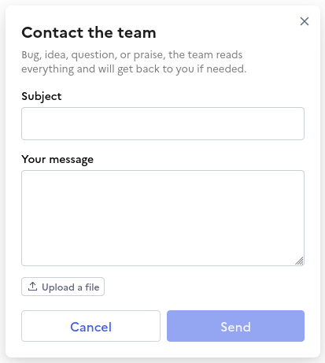

# Support widget

This is a standalone contact form widget. It is meant to be easily embeddable in any LaSuite website, whether they use the [UI kit](https://github.com/suitenumerique/ui-kit) or not.



## Usage instructions for UI kit apps

_Any one wanting to fill this out is welcome to do so :)_

## Usage instructions for non-UI kit apps

If you don't use the UI kit, you are expected to do a few things to correctly embed the widget:

- Include the support.js script, that handles the whole panel logic and styling. Since the script is a tad bit heavy, it is recommended to load it on-demand, for example when the user clicks the trigger button.
- Create a trigger button that closes and opens the panel and follows appropriate accessibility guidelines (see example below)
- Depending on your app, fine-tune the popup position (see example below)

### Example

Here is a complete, annotated, vanilla JS example on how to embed the widget in a non-UI kit app.

Adapt it to your app's context, but please keep in mind: aria attributes and keyboard behavior should match the example, to ensure an accessible experience for every users.

```js
const SUPPORT_SCRIPT_SRC =
  'https://lasuite.numerique.gouv.fr/widgets/support.js'
const SUPPORT_API = 'https://lasuite.numerique.gouv.fr/api/support/'
/* To fill-in with your app name, e.g. "grist". Check out the list of accepted channels in src/lib/support/channels.ts */
const SUPPORT_CHANNEL = YOUR_CHANNEL_NAME

/* Create the trigger button. */
const supportButton = document.createElement('button')
supportButton.type = 'button'
/* Set the text alternative for the button */
supportButton.setAttribute('aria-label', 'Contacter le support')
supportButton.lang = 'fr'
/* Add aria attributes related to the Disclosure ARIA Authoring Practices Guide pattern */
supportButton.setAttribute('aria-controls', 'lasuite-widget-support-root')
supportButton.setAttribute('aria-expanded', 'false')
/* Render the "?" icon */
supportButton.innerHTML = `
    <svg xmlns="http://www.w3.org/2000/svg" width="24" height="24" viewBox="0 0 22 22" fill="none" aria-hidden="true">
      <path d="M10.7578 13.8291c.3231 0 .5971.1022.8213.3066.224.2044.3358.465.3359.7813 0 .3165-.1117.5778-.3359.7822s-.4982.3066-.8213.3067c-.3165 0-.5905-.1023-.82128-.3067-.22423-.211-.33593-.4722-.33593-.7822.0001-.3098.1118-.5671.33593-.7715.22418-.211.49818-.3164.82128-.3164m.336-7.91406c.5802 0 1.1146.10229 1.6025.30664.4946.20444.8907.49835 1.1875.88086.2967.38244.4453.84729.4453 1.39453 0 .58026-.1486 1.03867-.4453 1.375-.2901.33623-.6759.66613-1.1572.98923-.3297.211-.5805.4123-.752.6035-.1715.1913-.2641.4157-.2773.6729v.0596c-.0001.0195-.0033.039-.0098.0586-.0132.1977-.1019.3664-.2666.5048-.1583.1385-.3732.2081-.6436.2081-.6264-.0001-.93934-.2805-.93941-.8409v-.1093c.00006-.4548.11186-.824.33591-1.1075.2309-.2836.5248-.5479.8809-.792.4218-.28994.7351-.53682.9394-.74117.211-.20435.3164-.46171.3164-.77148 0-.33635-.1253-.61026-.3759-.82129-.2439-.21753-.5667-.3261-.9688-.32618-.1978 0-.3832.03269-.5547.09864-.1647.06594-.3198.16188-.46481.28711-.13833.11862-.26398.26648-.37598.44433l-.1582.20801c-.09228.12524-.20413.22434-.33594.29688-.12525.07251-.27711.10836-.45508.10839-.2043 0-.38574-.06873-.54394-.20703-.15828-.13849-.23731-.32703-.23731-.56445.00002-.0922.00636-.17779.01954-.25684.01976-.08563.04618-.1712.0791-.25683.15168-.46165.50144-.86093 1.04882-1.19727.55389-.33621 1.2559-.50485 2.1065-.50488" fill="currentColor"/>
      <path d="M11 0c6.0751 0 11 4.92487 11 11 0 6.0751-4.9249 11-11 11-6.07513 0-11-4.9249-11-11C0 4.92487 4.92487 0 11 0m0 2c-4.97056 0-9 4.02944-9 9 0 4.9706 4.02944 9 9 9 4.9706 0 9-4.0294 9-9 0-4.97056-4.0294-9-9-9" fill="currentColor"/>
    </svg>
  `

supportButton.addEventListener('click', () => {
  window._lasuite_widget = window._lasuite_widget || []
  /**
   * The form can be initialized with the logged in user's email address, so that it doesn't show the email input.
   * If no email is provided, the form renders an email input.
   */
  const email = maybeGetUserEmailFromYourApp()

  /** Toggle the support popup depending on whether it is currently shown or not */
  if (supportButton?.getAttribute('aria-expanded') === 'false') {
    window._lasuite_widget.push([
      'support',
      'init',
      {
        api: SUPPORT_API,
        channel: SUPPORT_CHANNEL,
        position: 'top-right',
        ...(email ? { email } : {}),
        // You can force the `locale` here ("en" and "fr" are supported),
        // but it automatically adapts to the document's lang if not provided.
      },
    ])
  } else {
    window._lasuite_widget.push(['support', 'close'])
  }

  /**
   * Load the support script only when clicking the button to prevent loading it for nothing
   *
   * This is obviously a simple example that could be improved or adapted to your app's context.
   */
  if (!document.getElementById('lasuite-support-widget')) {
    const script = document.createElement('script')
    script.id = 'lasuite-support-widget'
    script.src = SUPPORT_SCRIPT_SRC
    script.async = true
    document.body.appendChild(script)
  }
})

document.addEventListener('lasuite-widget-support-opened', (event) => {
  /* Don't forget to update the trigger button's aria-expanded attribute on opening */
  supportButton?.setAttribute('aria-expanded', 'true')

  /* Here, you can tinker with the popup's styles if needed. Example: */
  // event.detail.dialogElement.style.setProperty('top', '56px', 'important');
  // event.detail.dialogElement.style.setProperty('right', '64px', 'important'); */
})

document.addEventListener('lasuite-widget-support-closed', () => {
  /* Don't forget to update the trigger button's aria-expanded attribute on closing, and focus back the trigger button */
  supportButton?.setAttribute('aria-expanded', 'false')
  supportButton?.focus()
})

/* Obviously at some point, render the trigger button! */
document.body.appendChild(supportButton)
```
